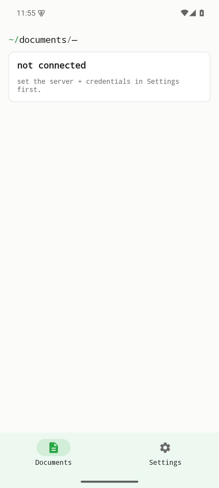
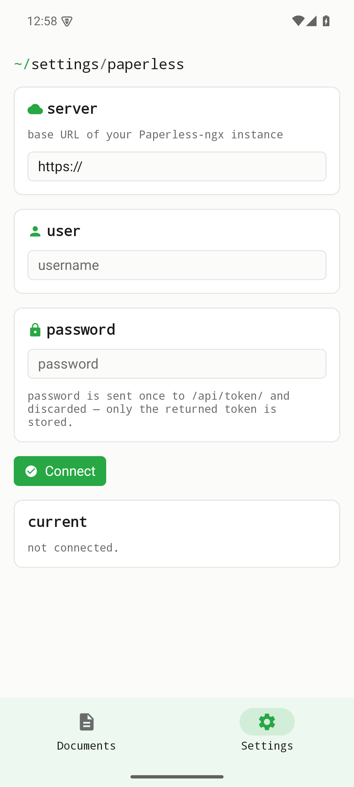

Dokumentmetadaten in Paperless-ngx suchen. iOS kann zusätzlich Originale anzeigen. Upload, Bearbeitung und Löschen sind nicht verfügbar; die Ergebnisliste zeigt die erste Seite.

Diese Seite beschreibt den Quellstand vom Oktober 2026. Die Änderungen sind unveröffentlicht und nicht Teil älterer Entwicklungsreleases. Lokale Prüfungen ersetzen keine Geräte-, Live-Server- oder Store-Abnahme.

[Current status / Aktueller Stand / État actuel](../current-status.qmd)

Historische Bildschirmfotos aus v0.1.0; sie belegen keine Prüfung des aktuellen Quellstands.

{width=320}

{width=320}
